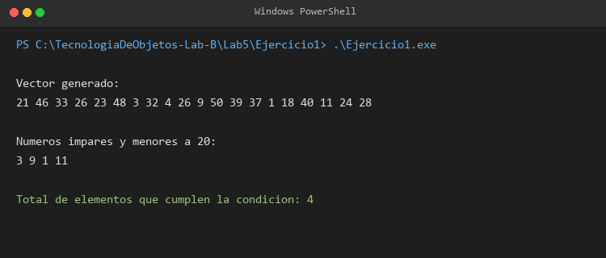
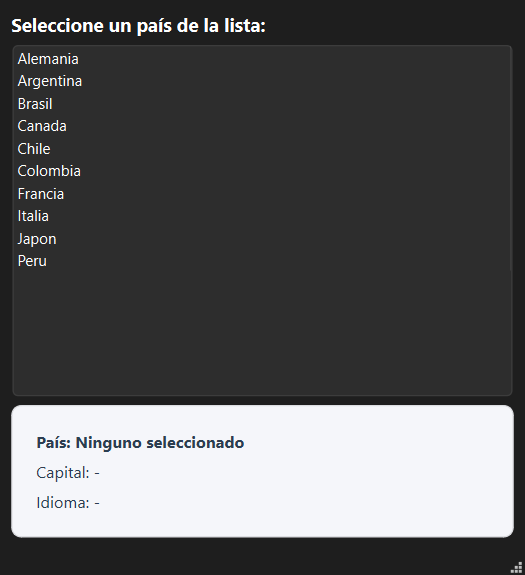
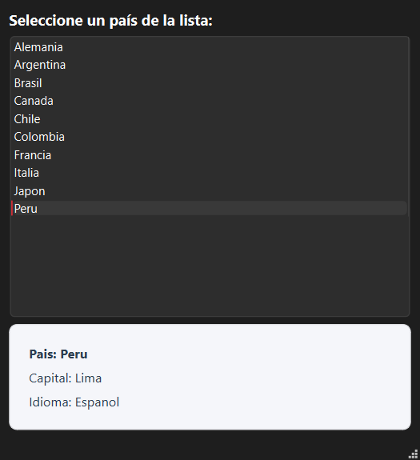
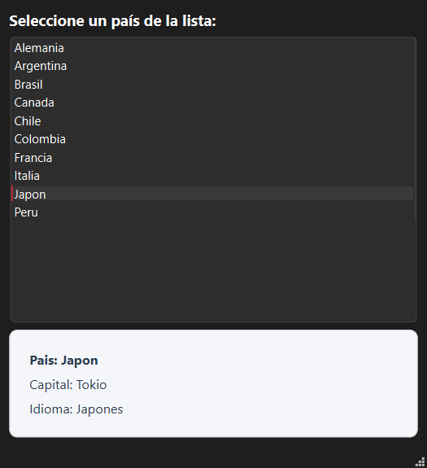

# Guía de Laboratorio 05: Funciones Lambda e Introducción a Widget App Qt

| INFORMACIÓN BÁSICA | |
| :--- | :--- |
| **ASIGNATURA:** | Tecnología de Objetos |
| **TÍTULO DE LA PRÁCTICA:** | Laboratorio 05: Funciones lambda e introducción a Widget App Qt |
| **NÚMERO DE PRÁCTICA:** | 5 |
| **AÑO LECTIVO:** | 2026 |
| **SEMESTRE:** | VI |
| **TIPO DE PRÁCTICA:** | Grupal |
| **INTEGRANTES:** | Chipana Jeronimo German Arturo<br>Baca Calsin Leonardo Juan José |
| **DOCENTE:** | Edith Giovanna Cano Mamani |

---

## I. Solución

### Repositorio
[https://github.com/ChipanaGerman/TecnologiaDeObjetos-Lab-B/tree/main/Lab5](https://github.com/ChipanaGerman/TecnologiaDeObjetos-Lab-B/tree/main/Lab5)

---

### Introducción
En el desarrollo de software moderno con C++, las funciones anónimas o expresiones lambda (incorporadas desde C++11) ofrecen una herramienta potente para definir lógica en línea sin necesidad de declarar clases funcionales u operadores externos. Estas funciones se combinan de forma natural con los algoritmos de la biblioteca estándar (STL) como `std::count_if` o `std::for_each`.

Asimismo, dentro del framework Qt, las expresiones lambda complementan el sistema de comunicación desacoplada por Señales y Ranuras (*Signals & Slots*). Permiten conectar eventos de la interfaz de usuario (como el clic sobre un elemento de una lista) directamente con acciones concretas sin sobrecargar innecesariamente la cabecera de la clase con slots triviales.

---

### Objetivos

#### Objetivo General
* Aplicar el uso de funciones lambda en C++ estándar y en el desarrollo de aplicaciones gráficas interactivas con el SDK de Qt, dominando la comunicación entre widgets mediante señales y ranuras.

#### Objetivos Específicos
* Implementar expresiones lambda como predicados unarios junto con algoritmos de la STL (`std::count_if`).
* Diseñar formularios visuales en Qt Designer utilizando controles como `QListWidget`, `QLabel` y layouts organizados.
* Establecer conexiones de eventos empleando la sintaxis moderna de `connect()` con funciones lambda y slots en Qt.

---

### Marco Conceptual

* **Funciones Lambda:** Expresiones que definen funciones anónimas en el mismo punto donde se requieren. Su estructura básica comprende:
  ```cpp
  [captura](parámetros) -> tipo_retorno { cuerpo }
  ```
  * `[=]`: Captura variables del entorno por valor.
  * `[&]`: Captura variables del entorno por referencia.
  * `[this]`: Captura el puntero al objeto actual, permitiendo acceder a sus miembros en métodos de clase.
* **`std::count_if`:** Algoritmo de la STL que itera sobre un rango $[inicio, fin)$ y contabiliza los elementos para los cuales un predicado unario retorna `true`.
* **Signals & Slots en Qt:** Mecanismo central de Qt para la comunicación entre objetos. Una **señal** es emitida cuando ocurre un evento, y una **ranura (slot)** o una **lambda** se ejecuta en respuesta.

---

## II. Desarrollo de los Ejercicios Propuestos

---

### Ejercicio 1: Conteo de Números Impares y Menores a 20 con `std::count_if` y Lambda

#### Enunciado
> *Contar los números impares y menores de 20 de un vector de números enteros generados de forma aleatoria (la solución puede usar el método std::count_if).*

#### Explicación de la Solución
1. **Generación Aleatoria:** Se utiliza el motor Mersenne Twister `std::mt19937` alimentado por `std::random_device` y una distribución uniforme `std::uniform_int_distribution<int>` para generar valores enteros entre 1 y 50.
2. **Almacenamiento:** Los valores se guardan en un `std::vector<int>`.
3. **Predicado Lambda:** Se define una expresión lambda que evalúa dos condiciones simultáneas: que el número sea menor a 20 y que su residuo módulo 2 sea distinto de cero:
   ```cpp
   auto esImparYMenorQue20 = [](int n) {
       return (n < 20) && (n % 2 != 0);
   };
   ```
4. **Conteo STL:** Se invoca a `std::count_if(numeros.begin(), numeros.end(), esImparYMenorQue20)` pasando la lambda como parámetro funcional.
5. **Recorrido:** Se emplea `std::for_each` con lambdas tanto para imprimir el vector completo como para listar los elementos específicos que cumplieron el criterio.

#### Código Fuente (`Lab5/Ejercicio1/main.cpp`)

```cpp
#include <iostream>
#include <vector>
#include <algorithm>
#include <random>

using namespace std;

int main() {
    random_device rd;
    mt19937 gen(rd());
    uniform_int_distribution<int> dis(1, 50);

    const int TAM = 20;
    vector<int> numeros(TAM);

    for (int i = 0; i < TAM; ++i) {
        numeros[i] = dis(gen);
    }

    cout << "Vector generado:" << endl;
    for_each(numeros.begin(), numeros.end(), [](int n) {
        cout << n << " ";
    });
    cout << "\n\n";

    // Condicion: impar y menor que 20
    auto esImparYMenorQue20 = [](int n) {
        return (n < 20) && (n % 2 != 0);
    };

    int total = count_if(numeros.begin(), numeros.end(), esImparYMenorQue20);

    cout << "Numeros impares y menores a 20:" << endl;
    for_each(numeros.begin(), numeros.end(), [&esImparYMenorQue20](int n) {
        if (esImparYMenorQue20(n)) {
            cout << n << " ";
        }
    });
    cout << "\n\n";

    cout << "Total de elementos que cumplen la condicion: " << total << endl;

    return 0;
}
```

#### Ejecución y Resultados



Al ejecutar el programa, se observa la generación de 20 números pseudoaleatorios, el filtrado dinámico mediante la función lambda y el conteo exacto de los elementos que cumplen la condición solicitada.

---

### Ejercicio 3: Interfaz Gráfica con Lista de Países, Capital e Idioma mediante Signals & Slots

#### Enunciado
> *Crear una interface gráfica (que implemente señales y slots) que muestre una lista de países, al dar clic sobre alguno que se muestre un Label o Text con el idioma y capital correspondiente.*

#### Diseño de la Interfaz Visual (`mainwindow.ui`)
* Se diseñó la ventana principal en Qt Designer utilizando un contenedor vertical (`QVBoxLayout`).
* **Componentes:**
  * `lblTitulo` (`QLabel`): Texto guía para el usuario (*"Seleccione un país de la lista:"*).
  * `listPaises` (`QListWidget`): Lista que presenta los nombres de los países disponibles.
  * `frameDetalle` (`QFrame`): Panel contenedor inferior para agrupar los datos del país.
  * `lblPais` (`QLabel`): Muestra el nombre del país seleccionado.
  * `lblCapital` (`QLabel`): Etiqueta para la capital correspondiente.
  * `lblIdioma` (`QLabel`): Etiqueta para el idioma oficial del país.

#### Estructura de Datos y Lógica de Comunicación
* Se definió una estructura simple `InfoPais`:
  ```cpp
  struct InfoPais {
      QString capital;
      QString idioma;
  };
  ```
* En `MainWindow`, los datos se indexan mediante un `QMap<QString, InfoPais>`.
* **Conexión mediante Signal, Slot y Expresión Lambda:**
  Se conecta la señal `&QListWidget::itemClicked` del control de lista utilizando una expresión lambda que captura el puntero `this`:
  ```cpp
  connect(ui->listPaises, &QListWidget::itemClicked, this, [this](QListWidgetItem *item) {
      onPaisSeleccionado(item);
  });
  ```
  Al activarse el clic, el slot `onPaisSeleccionado` recupera la información del mapa y actualiza dinámicamente las etiquetas visuales.

#### Códigos Fuente

##### Archivo de Cabecera (`Lab5/Ejercicio3/mainwindow.h`)

```cpp
#ifndef MAINWINDOW_H
#define MAINWINDOW_H

#include <QMainWindow>
#include <QListWidgetItem>
#include <QMap>

QT_BEGIN_NAMESPACE
namespace Ui { class MainWindow; }
QT_END_NAMESPACE

struct InfoPais {
    QString capital;
    QString idioma;
};

class MainWindow : public QMainWindow
{
    Q_OBJECT

public:
    MainWindow(QWidget *parent = nullptr);
    ~MainWindow();

private slots:
    void onPaisSeleccionado(QListWidgetItem *item);

private:
    Ui::MainWindow *ui;
    QMap<QString, InfoPais> mPaises;

    void cargarPaises();
};

#endif // MAINWINDOW_H
```

##### Implementación (`Lab5/Ejercicio3/mainwindow.cpp`)

```cpp
#include "mainwindow.h"
#include "ui_mainwindow.h"

MainWindow::MainWindow(QWidget *parent)
    : QMainWindow(parent)
    , ui(new Ui::MainWindow)
{
    ui->setupUi(this);
    setWindowTitle("Ejercicio 3 - Informacion de Paises");

    cargarPaises();

    // Conexion con Signal y Slot usando lambda
    connect(ui->listPaises, &QListWidget::itemClicked, this, [this](QListWidgetItem *item) {
        onPaisSeleccionado(item);
    });
}

MainWindow::~MainWindow()
{
    delete ui;
}

void MainWindow::cargarPaises()
{
    mPaises = {
        {"Peru", {"Lima", "Espanol"}},
        {"Argentina", {"Buenos Aires", "Espanol"}},
        {"Brasil", {"Brasilia", "Portugues"}},
        {"Chile", {"Santiago", "Espanol"}},
        {"Colombia", {"Bogota", "Espanol"}},
        {"Francia", {"Paris", "Frances"}},
        {"Alemania", {"Berlin", "Aleman"}},
        {"Italia", {"Roma", "Italiano"}},
        {"Japon", {"Tokio", "Japones"}},
        {"Canada", {"Ottawa", "Ingles y Frances"}}
    };

    for (auto it = mPaises.begin(); it != mPaises.end(); ++it) {
        ui->listPaises->addItem(it.key());
    }
}

void MainWindow::onPaisSeleccionado(QListWidgetItem *item)
{
    if (!item) return;

    QString nombrePais = item->text();
    if (mPaises.contains(nombrePais)) {
        InfoPais info = mPaises[nombrePais];
        ui->lblPais->setText("Pais: " + nombrePais);
        ui->lblCapital->setText("Capital: " + info.capital);
        ui->lblIdioma->setText("Idioma: " + info.idioma);
    }
}
```

##### Punto de Entrada (`Lab5/Ejercicio3/main.cpp`)

```cpp
#include "mainwindow.h"
#include <QApplication>

int main(int argc, char *argv[])
{
    QApplication a(argc, argv);
    MainWindow w;
    w.show();
    return a.exec();
}
```

##### Proyecto qmake (`Lab5/Ejercicio3/Ejercicio3_Paises.pro`)

```qmake
QT       += core gui

greaterThan(QT_MAJOR_VERSION, 4): QT += widgets

CONFIG += c++17

SOURCES += \
    main.cpp \
    mainwindow.cpp

HEADERS += \
    mainwindow.h

FORMS += \
    mainwindow.ui
```

#### Pruebas de Ejecución de la Interfaz Gráfica

| Estado Inicial | Selección de País (Perú) | Selección de País (Japón) |
| :---: | :---: | :---: |
|  |  |  |

* En el estado inicial, las etiquetas muestran los valores por defecto sin selección activa.
* Al hacer clic sobre *"Peru"*, la señal emitida por `QListWidget` dispara la lambda que actualiza las etiquetas con la capital (*Lima*) y el idioma (*Espanol*).
* Al seleccionar *"Japon"*, la interfaz refleja de forma inmediata la capital (*Tokio*) y el idioma (*Japones*).

---

## III. Conclusiones

1. **Claridad y Expresividad con Lambdas:** El uso de funciones lambda en C++ permite implementar predicados de filtrado de manera directa y concisa en el mismo lugar de su llamada, evitando la necesidad de funciones globales o clases de objetos función auxiliares para tareas puntuales.
2. **Sinergia entre STL y Lambdas:** La integración de `std::count_if` con expresiones lambda proporciona una solución declarativa y eficiente para el análisis de colecciones de datos, reduciendo errores asociados a contadores manuales o bucles tradicionales.
3. **Flexibilidad en el Sistema de Señales y Slots:** La sintaxis moderna de `QObject::connect` con soporte para funciones lambda permite manejar eventos de interfaz de usuario de manera compacta, manteniendo la modularidad del código y garantizando la verificación estricta de tipos durante la compilación.

---

## IV. Referencias
* Documentación oficial de Qt 6: [https://doc.qt.io/](https://doc.qt.io/)
* CppReference - Lambda expressions: [https://en.cppreference.com/w/cpp/language/lambda](https://en.cppreference.com/w/cpp/language/lambda)
* CppReference - `std::count_if`: [https://en.cppreference.com/w/cpp/algorithm/count](https://en.cppreference.com/w/cpp/algorithm/count)
* Qt Creator Manual: [https://doc.qt.io/qtcreator/](https://doc.qt.io/qtcreator/)
